

  

 

  

  

 

## 🕯️ [Rushda](https://ruushhdaa.github.io/digital-portfolio/)

> *B.Tech CSE (Data Science) · MITAOE, Pune · Year 2 of 4*

My focus is on **cyber adversarial analytics**: the convergence of data science and cybersecurity, where both are not domains in themselves but rather an art. I create adaptive solutions that understand what is normal to detect what rules won't ever be able to.

Utility is more important than benchmarking for me and the majority of my curiosity goes into the unexplored realms of machine learning security.

In the non-tech space I adore reading, sketching and the nature outdoors.

 

---

## 🔗 Socials

  

 

---

## 🛠️ Tech Stack

| **category** | **tech stack** |
|:---:|:---|
| **languages** |       |
| **ai / ml** |          |
| **frontend** |        |
| **backend** |       |
| **databases** |      |
| **cloud / deployment** |     |
| **security** |       |
| **devops / tools** |      |
| **blockchain** |     |

 

---

## 📊 GitHub Stats

 

## 📈 Activity

  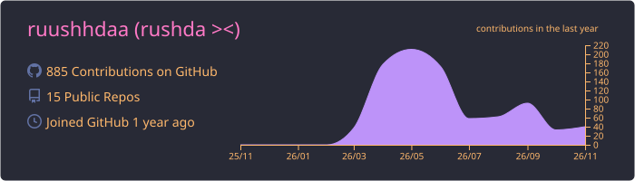

  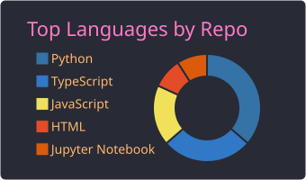
  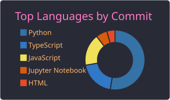
  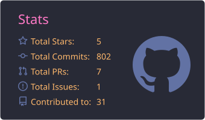

 

---

## 🚀 Featured Projects

<table>
<tr>
<td width="50%" valign="top">

### ⚡ [NEITH](https://github.com/ruushhdaa/neith)
**Network Entity Intelligence & Threat Hunter**

> *The Egyptian goddess Neith wove the fabric of reality and hunted across it.*

AI-powered NIDS that builds a live graph every 10s — nodes are IPs, edges are connections. GraphSAGE GNN trained on CICIDS 2017 at **83.5% accuracy**, 28 CICIDS-aligned features per IP from live packet capture. Maps anomalies to 9 MITRE ATT&CK techniques with **90% conformal prediction intervals** and ADWIN drift detection. Full-stack Egyptian temple war room dashboard.

</td>
<td width="50%" valign="top">

### 🏛️ [THEODRA](https://github.com/ruushhdaa/theodra)
**Workplace Harassment Early-Warning System**

> *Named after Empress Theodora — institutional protection through mathematical privacy.*

Three-layer POSH Act compliance system. Isolation Forest over communication **metadata only** — never touches message content. **k-anonymity (k≥5)** prevents re-identification before any signal reaches human review. Multi-party IC sign-off required for escalation. Full statutory deadline tracking (90-day inquiry, 10-day report, 60-day implementation).

</td>
</tr>
<tr>
<td width="50%" valign="top">

### 🌐 [SHURI](https://github.com/ruushhdaa/shuri)
**IoT Threat Detection Platform**

Fully local LAN scanner — no cloud dependency, runs on a laptop. Blast radius scoring based on **network trust chains**, not port count — a router scores 10 because every device trusts it, not because it has open ports. Honeypot services captured **100% of probe traffic** in testing. Firewall-aware: cut an IP camera's blast radius **10→7** when Telnet was filtered.

</td>
<td width="50%" valign="top">

### 🔐 [Proof of Face](https://github.com/ruushhdaa/proof-of-face)
**Privacy-Preserving Facial Discovery & Blockchain Attestation**

Zero-biometric-on-chain by design. Face embeddings (128-D) stay in volatile local memory, immediately hashed to SHA-256. Only a `Keccak256(FaceHash ‖ PostURL ‖ Timestamp)` commitment touches the EVM. Any verifier with the original inputs can reproduce the hash — **nobody learns the face**. Runs on Polygon Amoy or local Py-EVM with zero gas.

</td>
</tr>
<tr>
<td width="50%" valign="top">

### 🧭 [ReRoute](https://github.com/ruushhdaa/reroute)
**AI-Powered Financial Journey Engine**

> *"Don't restart. Reroute."*

Guides customers from plain-language goal to completion across insurance claims and lending. When a doc discrepancy is found, the system **never cold-rejects** — it isolates the exact blocker and reroutes in-place. Deterministic risk scoring with traceable arithmetic. **84.6% resolution rate** on synthetic benchmark. Zero autonomous financial approvals.

</td>
<td width="50%" valign="top">

### 🕵️ [ParadigmHMX](https://github.com/ruushhdaa/ParadigmHMX)
**InsiderTrace — Financial Crime & Insider Risk Intelligence**

9 specialized detectors across financial and insider signals. Causal cross-domain correlation: Unauthorized Access → Security Parameter Override → Rapid Outbound Transfer. **100% recall** on planted multi-signal attacks. **9.4% FPR** on 32 hard negatives. +**29.7% F1 lift** over transaction-only baseline. Cryptographic SHA-256 evidence export with on-chain verification.

</td>
</tr>
</table>

 

---

## 🏅 Verified Certifications & Digital Badges

 

### 🛡️ Core Certifications & Verified Digital Badges

  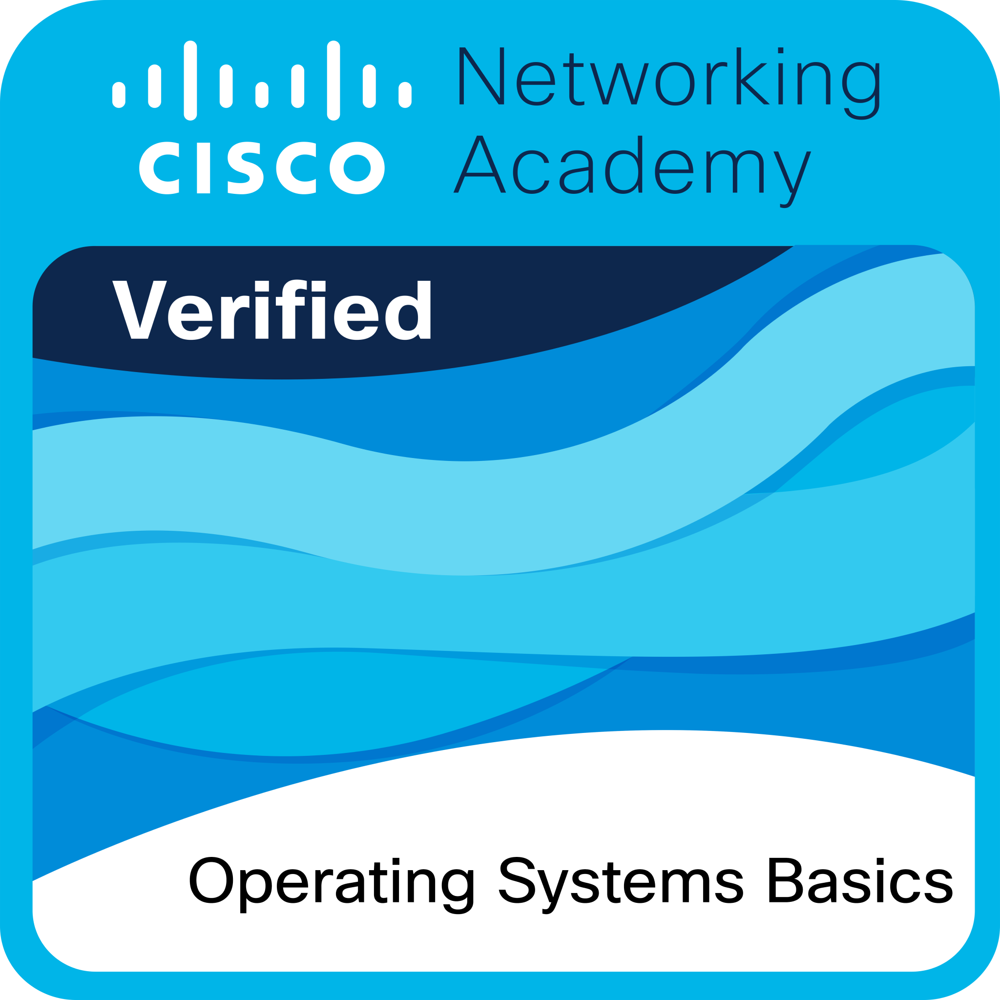
  
  
  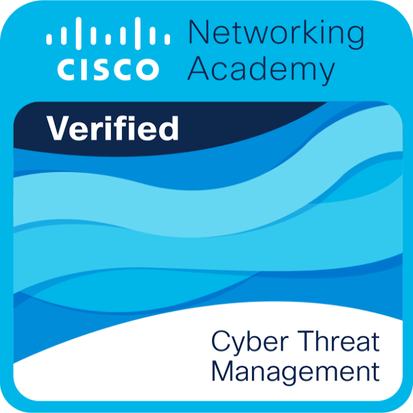
  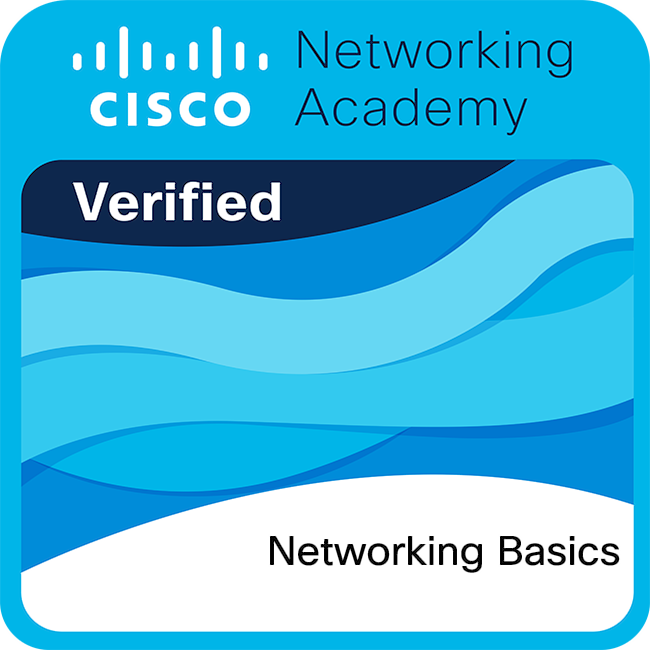

  
  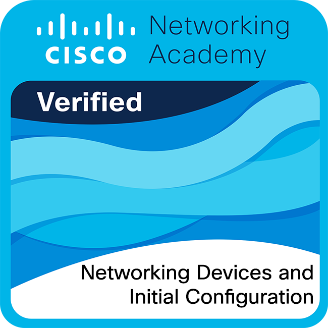
  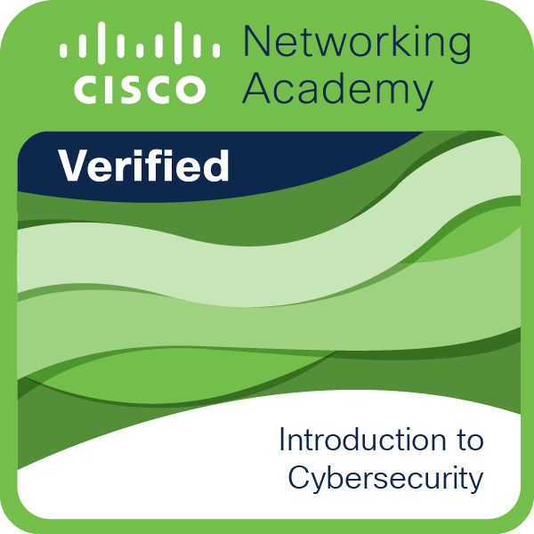
  
  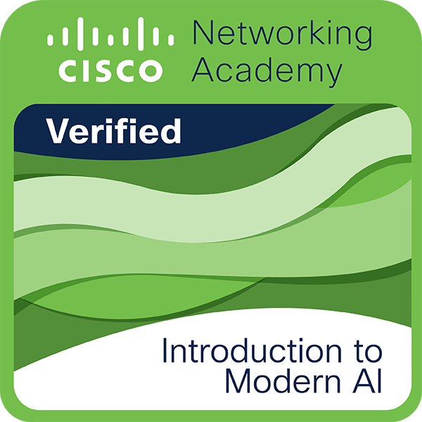
  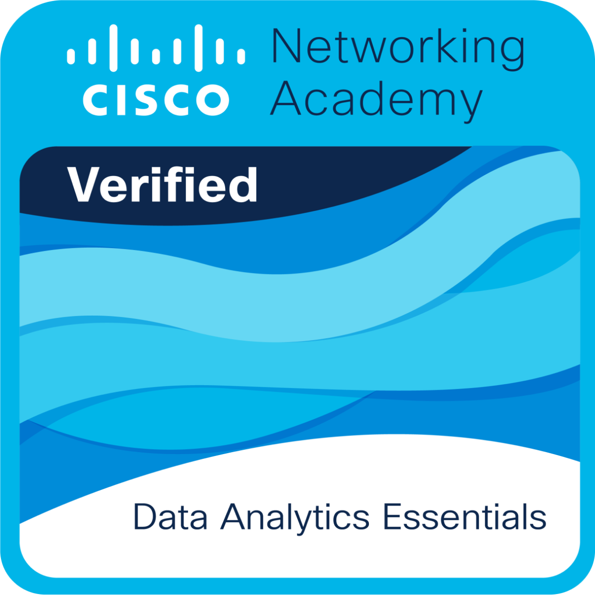

  
  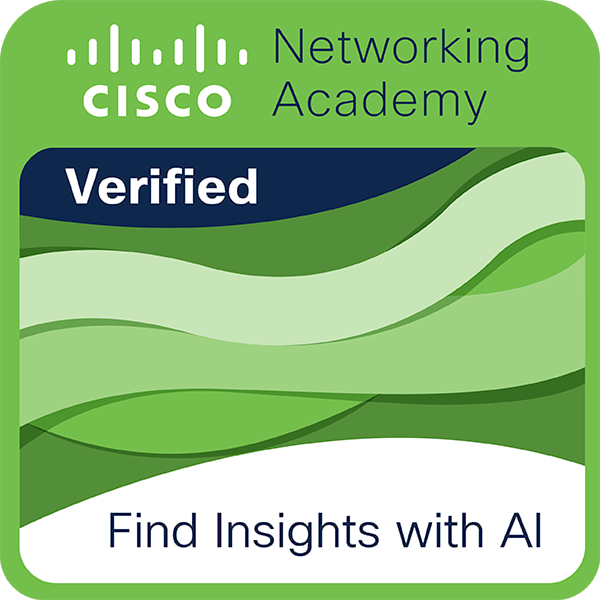
  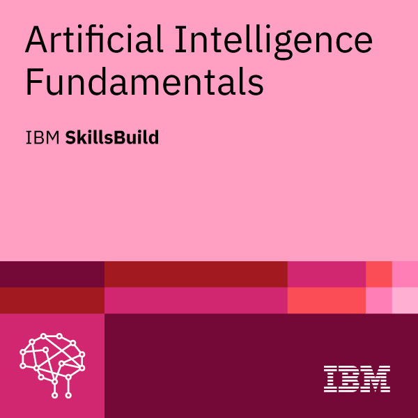

 

---

## 🗺️ 3D Contribution Landscape

  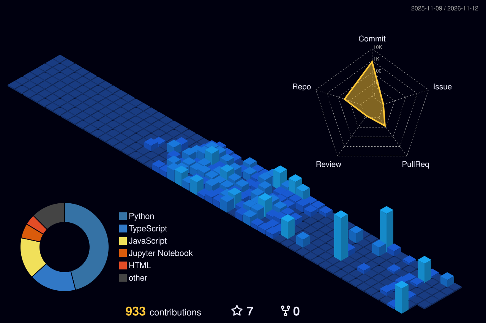

## 🕹️ Contribution Arcade

  <picture>
    <source
      media="(prefers-color-scheme: dark)"
      srcset="https://raw.githubusercontent.com/ruushhdaa/ruushhdaa/output/galaga-contribution-graph-dark.svg"
    />

  <source
      media="(prefers-color-scheme: light)"
      srcset="https://raw.githubusercontent.com/ruushhdaa/ruushhdaa/output/galaga-contribution-graph.svg"
   />

  
  </picture>

---

 

*✦ &nbsp;&nbsp;&nbsp; . &nbsp;&nbsp;&nbsp; ˚ &nbsp;&nbsp;&nbsp; . &nbsp;&nbsp;&nbsp; ✦ &nbsp;&nbsp;&nbsp; . &nbsp;&nbsp;&nbsp; ˚ &nbsp;&nbsp;&nbsp; ✦ &nbsp;&nbsp;&nbsp; . &nbsp;&nbsp;&nbsp; ˚*
*˚ &nbsp;&nbsp;&nbsp; . &nbsp;&nbsp;&nbsp; ✦ &nbsp;&nbsp;&nbsp; . &nbsp;&nbsp;&nbsp; ˚ &nbsp;&nbsp;&nbsp; . &nbsp;&nbsp;&nbsp; ✦ &nbsp;&nbsp;&nbsp; ˚ &nbsp;&nbsp;&nbsp; . &nbsp;&nbsp;&nbsp; ✦*
*˚ &nbsp;&nbsp;&nbsp; . &nbsp;&nbsp;&nbsp; ✦ &nbsp;&nbsp;&nbsp; . &nbsp;&nbsp;&nbsp; ˚ &nbsp;&nbsp;&nbsp; . &nbsp;&nbsp;&nbsp; ✦ &nbsp;&nbsp;&nbsp; ˚ &nbsp;&nbsp;&nbsp; . &nbsp;&nbsp;&nbsp; ✦*

***alis volat propiis***

*˚ &nbsp;&nbsp;&nbsp; . &nbsp;&nbsp;&nbsp; ✦ &nbsp;&nbsp;&nbsp; . &nbsp;&nbsp;&nbsp; ˚ &nbsp;&nbsp;&nbsp; . &nbsp;&nbsp;&nbsp; ✦ &nbsp;&nbsp;&nbsp; ˚ &nbsp;&nbsp;&nbsp; . &nbsp;&nbsp;&nbsp; ✦*
*˚ &nbsp;&nbsp;&nbsp; . &nbsp;&nbsp;&nbsp; ✦ &nbsp;&nbsp;&nbsp; . &nbsp;&nbsp;&nbsp; ˚ &nbsp;&nbsp;&nbsp; . &nbsp;&nbsp;&nbsp; ✦ &nbsp;&nbsp;&nbsp; ˚ &nbsp;&nbsp;&nbsp; . &nbsp;&nbsp;&nbsp; ✦*

*she flies with her own wings*

*˚ &nbsp;&nbsp;&nbsp; . &nbsp;&nbsp;&nbsp; ✦ &nbsp;&nbsp;&nbsp; . &nbsp;&nbsp;&nbsp; ˚ &nbsp;&nbsp;&nbsp; . &nbsp;&nbsp;&nbsp; ✦ &nbsp;&nbsp;&nbsp; ˚ &nbsp;&nbsp;&nbsp; . &nbsp;&nbsp;&nbsp; ✦*
*˚ &nbsp;&nbsp;&nbsp; . &nbsp;&nbsp;&nbsp; ✦ &nbsp;&nbsp;&nbsp; . &nbsp;&nbsp;&nbsp; ˚ &nbsp;&nbsp;&nbsp; . &nbsp;&nbsp;&nbsp; ✦ &nbsp;&nbsp;&nbsp; ˚ &nbsp;&nbsp;&nbsp; . &nbsp;&nbsp;&nbsp; ✦*
*˚ &nbsp;&nbsp;&nbsp; . &nbsp;&nbsp;&nbsp; ✦ &nbsp;&nbsp;&nbsp; . &nbsp;&nbsp;&nbsp; ˚ &nbsp;&nbsp;&nbsp; . &nbsp;&nbsp;&nbsp; ✦ &nbsp;&nbsp;&nbsp; ˚ &nbsp;&nbsp;&nbsp; . &nbsp;&nbsp;&nbsp; ✦*

 

  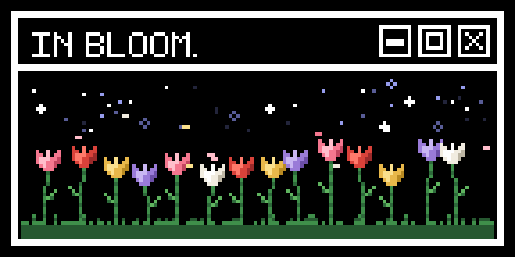

